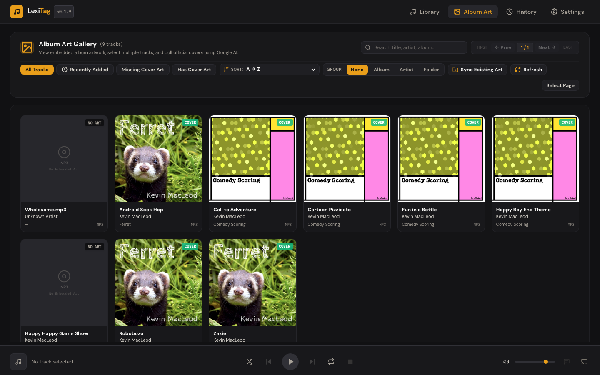
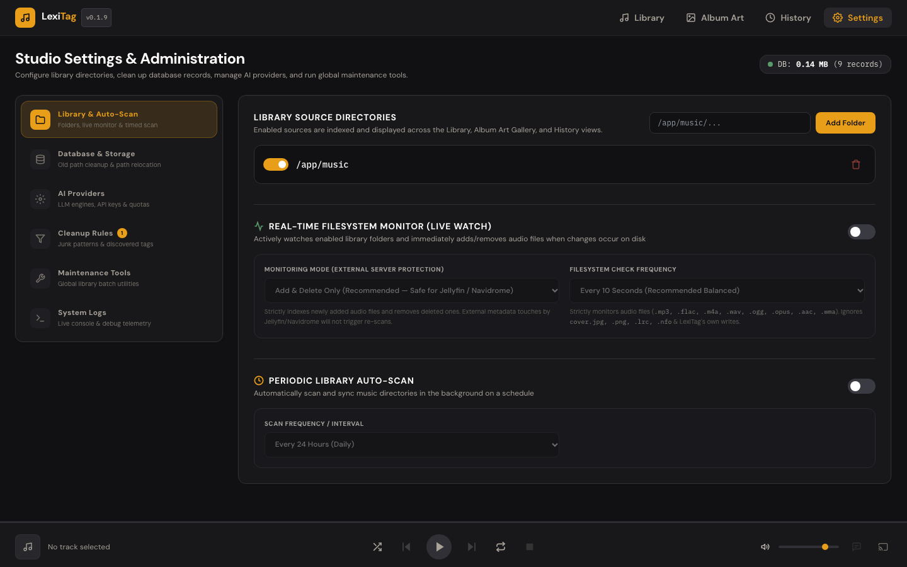
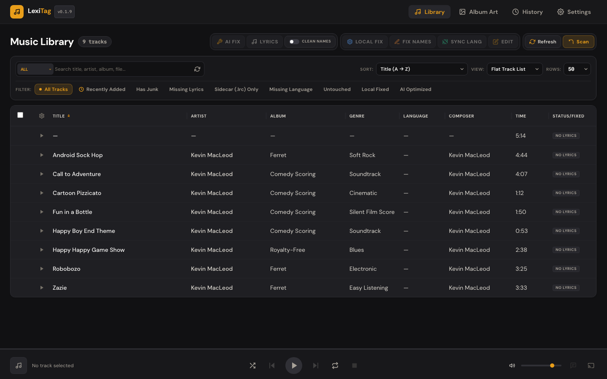

<div align="center">


# LexiTag

**Self-hosted music metadata, lyrics, and artwork manager**

[](CHANGELOG.md)
[](https://hub.docker.com/r/lokeshsg/lexitag)
[](LICENSE)
[](https://www.python.org/)
[](https://reactjs.org/)

LexiTag scans your local audio files, strips spam and promotional watermarks from tags, fills in missing metadata and lyrics, manages cover art, and lets you browse and edit your collection from a clean web interface.

[Quick Start](#quick-start) · [Docker Deployment](#docker-deployment) · [Features](#features) · [Configuration](#configuration) · [Changelog](CHANGELOG.md)

</div>

---

## Screenshots

<table>
<tr>
<td width="50%">

**Music Library**


</td>
<td width="50%">

**Album Art Gallery**


</td>
</tr>
<tr>
<td width="50%">

**Settings & Automation**


</td>
<td width="50%">

**Filters & Recently Added**


</td>
</tr>
</table>

---

## Features

### Metadata Cleaning & Tag Enrichment
- **Junk Removal**: Strips embedded download-site URLs, watermarks, promotional tags, and comment spam using built-in and custom cleanup rules.
- **AI Tag Lookup**: Identifies missing or corrupted track titles, artists, albums, release years, genres, composers, and languages using your configured LLM provider (Google Gemini, OpenAI-compatible APIs, or Anthropic Claude).
- **Three-Stage Pipeline**: Runs local cleanup rules first, queries the LLM with filename and folder context second, and re-runs local cleanup rules on the returned metadata so watermark strings never slip back in.

### Album Art Gallery
- Browse cover art by **Album**, **Artist**, **Folder**, or **Flat Track List**.
- Filter by **All Tracks**, **Recently Added**, **Missing Cover Art**, or **Has Cover Art**, and sort by **A → Z**, **Recently Added**, **Recently Scanned**, or **Release Year**.
- Search for official high-resolution cover art across Apple Music, Deezer, Discogs, Wikipedia, MusicBrainz, and Cover Art Archive, or paste a direct image/release URL.
- Writes both embedded audio tags (`APIC` / `METADATA_BLOCK_PICTURE` / `covr`) and folder-level `cover.jpg` / `folder.jpg` files so media servers like **Navidrome** and **Jellyfin** pick up changes immediately.

### Lyrics Management
- Fetches time-synced (`.lrc`) and plain-text lyrics from LRCLIB, with web search fallback for regional and soundtrack releases.
- Automatically detects existing `.lrc` sidecar files on disk (`Sidecar (.lrc) Only` filter) and lets you embed them directly into audio tags with one click.

### Real-Time Filesystem Monitor (Live Watch) & Auto-Scan
- **Live Filesystem Watcher**: Monitors your library folders in the background and automatically indexes newly added or deleted audio files within seconds.
  - **Media Server Safe Mode (`Add & Delete Only`)**: Ignores metadata or sidecar touches from external tools like Jellyfin or Navidrome, and strictly watches supported audio extensions (`.mp3`, `.flac`, `.m4a`, `.wav`, `.ogg`, `.opus`, `.aac`, `.wma`, `.alac`, `.aiff`).
  - **Self-Write Suppression**: Tag edits, cover updates, and file renames performed inside LexiTag are automatically suppressed so they never trigger redundant re-scans.
- **Scheduled Auto-Scan**: Optional periodic background scanner with preset intervals (`1h`, `6h`, `12h`, `24h`, `7d`) or custom minute/hour schedules.

### Library Organization & Database Maintenance
- **Recently Added & Multi-Sort**: Quickly view newly imported music in both the Library and Album Art pages, or sort by title, artist, album, year, scan time, or fix time.
- **Database Cleanup**: Dedicated maintenance tools in `/settings` to inspect total vs. active tracks, purge orphaned records from old or removed directory paths, and run non-blocking SQLite `VACUUM` to reclaim disk space.
- **Change History & Revert**: Every tag edit is logged with before/after values so you can revert individual fields, tracks, or entire batches at any time.
- **Adaptive Mobile & Multi-Viewport UI**: Automatically detects screen dimensions and touch/pointer capabilities (`320px` phones, tablets, laptops, and ultra-wide monitors) to render touch-friendly track cards, symmetrical action toolbars, 2-column mobile album grids, and responsive modals.
- **Built-in Audio Player & UPnP/DLNA Casting**: Play tracks directly in the browser with HTTP Range seek support, or cast to DLNA renderers on your LAN.

---

## Requirements

- **Docker** (recommended), or Python 3.12+ and Node 20+ for local development
- An API key for **Google Gemini** (free tier available), **OpenAI**, or **Anthropic**

---

## Quick Start

```bash
# 1. Create a working directory
mkdir lexitag && cd lexitag

# 2. Download the example environment file
curl -O https://raw.githubusercontent.com/lokesh-sg/lexitag/main/.env.example
cp .env.example .env
# Edit .env and set your LLM_API_KEY

# 3. Create directories for music and persistent data
mkdir -p music data

# 4. Start the container
docker compose up -d

# 5. Open the web UI
open http://localhost:3030
```

On first launch, open **Settings → Library & Scanning**, confirm `/app/music` is listed under Library Sources, and click **Scan**.

---

## Docker Deployment

```yaml
services:
  lexitag:
    image: lokeshsg/lexitag:latest
    container_name: lexitag
    network_mode: "host"       # Needed for UPnP/DLNA discovery on LAN
    environment:
      - MUSIC_DIR=/app/music
      - DATA_DIR=/app/data
    volumes:
      - ./music:/app/music     # Path to your host music library
      - ./data:/app/data       # Persistent SQLite database & logs
    restart: unless-stopped
```

> **Note:** If you do not use UPnP/DLNA casting, you can remove `network_mode: "host"` and map the port directly with `ports: ["3030:3030"]`.

---

## Running Locally (Development)

**Backend:**
```bash
cd backend
python3 -m venv .venv && source .venv/bin/activate
pip install -r requirements.txt
uvicorn app.main:app --reload --port 3020
```

**Frontend:**
```bash
cd frontend
npm install
npm run dev
# Runs on http://localhost:3010 (proxied to backend on port 3020)
```

---

## Configuration

Settings can be configured via `.env` or directly in the web UI under **Settings**.

| Variable | Description | Default |
|---|---|---|
| `LLM_API_KEY` | API key for your default LLM provider | — |
| `LLM_API_BASE_URL` | Base URL for the completions endpoint | Gemini endpoint |
| `LLM_MODEL` | Model name | `gemini-2.0-flash` |
| `MUSIC_DIR` | Music library path inside the container | `/app/music` |
| `DATA_DIR` | Database and log storage path inside the container | `/app/data` |
| `LEXITAG_AUTH_TOKEN` | Optional bearer token to require authentication | unset |
| `ALLOWED_ORIGINS` | Allowed CORS origins (comma-separated) | `*` |

---

## Security

- **Non-Root Container**: Runs as an unprivileged `lexitag` user inside Docker.
- **Path Jailing**: File operations are restricted strictly to `MUSIC_DIR` and `DATA_DIR`.
- **SSRF Protection**: Outgoing image fetches validate `http://` and `https://` schemes before connecting.
- **Encrypted API Keys**: Provider keys configured in the UI are encrypted at rest in SQLite.

---

## Changelog

See [CHANGELOG.md](CHANGELOG.md) for full release notes.

**Latest Release: [v0.1.9 (Build 20261018)](CHANGELOG.md#019--2026-10-18-build-20261018)** — Adaptive Mobile & Multi-Viewport Responsive UI, Real-Time Filesystem Monitor (Live Watch), Database & Old Path Cleanup, Dedicated Settings Page, Recently Added Filter & Sorting, and Dependency Security Updates.


